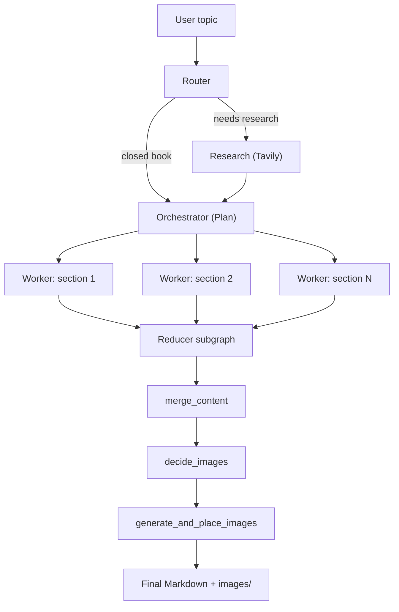

# ✍️ Blog Writing Agent

An autonomous technical blog writer built with **LangGraph**, **Groq**, **Tavily** and **Streamlit**.
Give it a topic and it decides whether it needs web research, plans the post, writes every section **in parallel**, adds diagrams or illustrations, and saves a finished Markdown file you can preview and download from a clean web UI.


---

## Table of contents

1. [Features](#features)
2. [How it works](#how-it-works)
3. [Project structure](#project-structure)
4. [Tech stack](#tech-stack)
5. [Setup](#setup)
6. [Configuration](#configuration)
7. [Running the app](#running-the-app)
8. [Using the UI](#using-the-ui)
9. [Backend deep dive](#backend-deep-dive)
10. [Image pipeline](#image-pipeline)
11. [Rate limits and token usage](#rate-limits-and-token-usage)
12. [Troubleshooting](#troubleshooting)
13. [Extending the project](#extending-the-project)
14. [Roadmap](#roadmap)
15. [Author](#author)

---

## Features

- **Smart routing:** an LLM router picks one of three modes per topic:
  - `closed_book`: evergreen concepts, no web search.
  - `hybrid`: evergreen topic plus fresh examples and tools from the web.
  - `open_book`: volatile topics ("latest", "this week", pricing, rankings), written as a news roundup.
- **Web research with Tavily:** scoped queries, URL de-duplication, date normalisation and a recency filter for open-book posts.
- **Structured planning:** the planner returns a validated `Plan` (title, audience, tone, blog kind, constraints and 3–5 tasks with goals, bullets and word targets).
- **Parallel writing:** one worker per section, fanned out with LangGraph `Send` and merged in order.
- **Word-budget aware:** topics like "…in 180 words" are respected by the planner.
- **Citations from evidence only:** workers may cite only URLs from the research results.
- **Automatic visuals:**
  - Technical **diagrams** are generated as Mermaid code and rendered to PNG, so the text is always crisp and correct.
  - Conceptual **illustrations** are generated with NVIDIA FLUX using text-free prompts.
- **Robust structured output:** a helper that works around Groq's `tool_use_failed` errors with retries and salvage of the failed generation.
- **Polished Streamlit UI:** live pipeline stepper, metric cards, plan cards, evidence cards, image gallery, logs, past-blog browser and downloads.

---

## How it works



| Stage | Node | What it does |
|---|---|---|
| 1 | `router` | Chooses the mode and, if needed, 3–10 search queries. |
| 2 | `research` | Runs up to 3 queries on Tavily, de-duplicates by URL, keeps up to 6 items and applies the recency filter in `open_book` mode. |
| 3 | `orchestrator` | Produces the `Plan` using the topic, the mode and the evidence. |
| 4 | `worker` (×N) | Writes one Markdown section per task, concurrently. |
| 5 | `reducer` | A subgraph that merges sections, picks images and inserts them. |

The reducer subgraph runs three steps:

1. `merge_content` joins the sections in task order under the blog title.
2. `decide_images` asks the LLM for 0–2 image specs. Python then inserts the placeholders into the Markdown, so the LLM never rewrites the blog.
3. `generate_and_place_images` renders each image, saves it under `images/`, replaces the placeholders and writes the final `.md` file.

---

## Project structure

```
LangGraph-Blog-Project/
├── bwa_backend.py              # LangGraph pipeline (compiled as `app`)
├── research_blog_frontend.py   # Streamlit UI
├── .env                        # API keys (not committed)
├── requirements.txt
├── images/                     # Generated images (created on demand)
└── <blog_title>.md             # Generated blogs (saved next to the app)
```

> The frontend imports the backend with `from bwa_backend import app`. If you rename the backend file, update that import.

---

## Tech stack

| Layer | Tool |
|---|---|
| Orchestration | LangGraph (`StateGraph`, `Send`, subgraphs) |
| LLM | Groq, model `openai/gpt-oss-120b`, through `langchain-groq` |
| Search | Tavily, through `langchain-community` |
| Schemas | Pydantic v2 |
| Diagrams | Mermaid rendered via `mermaid.ink` |
| Illustrations | NVIDIA hosted FLUX (`ai.api.nvidia.com`) |
| Image validation | Pillow |
| UI | Streamlit, pandas |

---

## Setup

### 1. Prerequisites

- Python 3.10 or newer
- API keys:
  - **Groq**: required
  - **Tavily**: optional. Without it, research returns no evidence.
  - **NVIDIA**: optional. Only needed for FLUX illustrations. Mermaid diagrams need no key.

### 2. Clone and create a virtual environment

```bash
git clone https://github.com/Sumit-342/researchflow-ai-agent.git
cd LangGraph-Blog-Project

python -m venv MYVENV

# Windows (PowerShell)
MYVENV\Scripts\Activate.ps1
# macOS / Linux
source MYVENV/bin/activate
```

### 3. Install dependencies

```bash
pip install -r requirements.txt
```

Example `requirements.txt`:

```txt
streamlit>=1.40
pandas
pydantic>=2
python-dotenv
requests
pillow
langgraph
langchain-core
langchain-groq>=0.3
langchain-community
tavily-python
```

### 4. Add your keys

Create a `.env` file in the project root:

```env
GROQ_API_KEY=your_groq_key
TAVILY_API_KEY=your_tavily_key
NVIDIA_API_KEY=your_nvidia_key
```

Never commit `.env`. Add it to `.gitignore`.

---

## Configuration

Most behaviour is controlled by a few constants in `bwa_backend.py`.

| Setting | Where | Purpose |
|---|---|---|
| `ChatGroq(model=...)` | LLM section | Model used everywhere. Swap it to try other Groq models. |
| `reasoning_effort="low"` | `ChatGroq(...)` | Cuts hidden reasoning tokens. Biggest single saving. |
| `max_retries`, `max_tokens` | `ChatGroq(...)` | Backoff on 429s and a cap on completion size. |
| `queries[:3]` | `research_node` | Max search queries per run. |
| `max_results=2` | `_tavily_search` | Results per query. |
| `evidence[:6]` | `research_node` | Max evidence items kept. |
| word targets | `ORCH_SYSTEM` | Section sizes and how they shrink for word limits. |
| image threshold | `decide_images` | Posts under ~400 words skip the image step entirely. |
| `max_concurrency` | `g.compile().with_config(...)` | How many workers run at once. |

Frontend settings (sidebar → *Research settings*): the as-of date and the recency window in days, used for open-book filtering.

---

## Running the app

```bash
streamlit run research_blog_frontend.py
```

Open the URL Streamlit prints, usually `http://localhost:8501`.

You can also run the backend without the UI:

```python
from bwa_backend import app

result = app.invoke({
    "topic": "Self-attention in the Transformer architecture in 180 words",
    "mode": "", "needs_research": False, "queries": [], "evidence": [],
    "plan": None, "as_of": "2026-01-01", "recency_days": 7,
    "sections": [], "merged_md": "", "md_with_placeholders": "",
    "image_specs": [], "final": "",
})
print(result["final"])
```

---

## Using the UI

**Sidebar**
- **Topic:** type your own or click a quick idea. Add a limit such as "in 500 words" if you want one.
- **Research settings:** set the as-of date and recency window.
- **Generate blog:** starts the run.
- **Past blogs:** every `*.md` in the project folder, searchable. Click one to load it.

**Main area**
- **Live pipeline:** Router → Research → Planner → Writers → Editor, with state per stage and section progress.
- **Metric cards:** words, read time, sections, sources, images and mode.
- **📝 Blog:** rendered article with local images, plus Markdown and ZIP bundle downloads.
- **🧩 Plan:** a card per section with its goal, bullets and word targets, and a word-budget chart.
- **🔎 Evidence:** clickable source cards and a CSV export.
- **🖼️ Images:** gallery, ZIP download and the image plan.
- **🧾 Logs:** node-by-node run log.

The UI streams the graph once and reads the final state from that stream, so a click costs one run, not two.

---

## Backend deep dive

### State

```python
class State(TypedDict):
    topic: str
    mode: str                 # closed_book | hybrid | open_book
    needs_research: bool
    queries: List[str]
    evidence: List[EvidenceItem]
    plan: Optional[Plan]
    as_of: str                # ISO date for recency filtering
    recency_days: int
    sections: Annotated[List[tuple[int, str]], operator.add]   # merged from parallel workers
    merged_md: str
    md_with_placeholders: str
    image_specs: List[dict]
    final: str
```

Every key a node reads must exist in `State`. LangGraph drops undeclared keys, which is why `as_of` and `recency_days` are declared.

### Key schemas

- `RouterDecision`: `needs_research`, `mode`, `queries`
- `Plan`: `blog_title`, `audience`, `tone`, `blog_kind`, `constraints`, `tasks[]`
- `Task`: `id`, `title`, `goal`, `bullets` (3–6), `target_words`, `tags`, `requires_research`, `requires_citations`, `requires_code`
- `ImageSpec`: `placeholder`, `filename`, `kind` (`diagram` or `illustration`), `alt`, `caption`, `after_heading`, `diagram_code`, `prompt`

### `structured_invoke`

Groq with `gpt-oss-120b` occasionally fails structured output with `tool_use_failed` (the model calls a tool named `json` that was not in the request). The helper:

1. Tries native `json_schema` mode first.
2. Falls back to function calling.
3. Salvages the JSON from Groq's `failed_generation` field when present.
4. Does **not** retry on rate-limit errors, because retries only burn more tokens.

### Heading matching

The LLM may return headings with non-breaking hyphens or a different `#` count. `_norm_heading` normalises Unicode, dash variants, whitespace and case before matching, so image placement does not silently fail.

---

## Image pipeline

| Kind | Used for | How it is made |
|---|---|---|
| `diagram` | Architectures, flows, pipelines, comparisons | LLM writes Mermaid → `mermaid.ink` renders a PNG |
| `illustration` | One conceptual hero visual | Text-free prompt → NVIDIA FLUX |

Why two paths: diffusion models cannot reliably draw text, so labels come out blurry or mirrored. Mermaid renders real text.

Details:
- Image filenames include a short hash of their source (diagram code or prompt), so an old image from another blog is never reused by accident.
- Existing images are reused only if Pillow can open and verify them.
- The file extension comes from the real bytes (`.jpg`, `.png`, `.webp`), not from the model's filename.
- If rendering fails, the blog still saves, with an `IMAGE GENERATION FAILED` block that shows the prompt and the error.
- Posts under about 400 words skip the image step to save tokens.

---

## Rate limits and token usage

Groq's free tier for `gpt-oss-120b` allows about 8,000 tokens per minute. One run makes many calls (router, planner, one per section, image planner), so it is easy to hit the cap.

What already helps:
- Limited worker concurrency
- A planner prompt that shrinks sections for small word budgets
- No image step for short posts
- No retries on rate-limit errors

If you still hit a limit:
- Wait about 60 seconds between runs, because earlier failed runs count against the same window.
- Use a smaller model for the router and image planner (for example `gpt-oss-20b`), since limits are per model.
- Upgrade to Groq's Dev Tier.

---

## Troubleshooting

| Symptom | Cause | Fix |
|---|---|---|
| `429 ... tokens per minute` | Groq TPM limit | See [Rate limits](#rate-limits-and-token-usage). |
| `tool_use_failed ... tool 'json'` | Groq function-calling quirk | Use `structured_invoke` for every structured call. |
| `KeyError: 'as_of'` | Missing keys in `State` | Declare `as_of` and `recency_days` in `State`. |
| `PIL.UnidentifiedImageError` in the UI | A corrupt file in `images/` | Delete `images/` and rerun. The UI also shows a warning instead of crashing. |
| Blurry or mirrored text in images | Diffusion models can't draw text | Use `kind="diagram"` (Mermaid) and keep illustration prompts text-free. |
| Images missing, no error | Heading mismatch | Check `_norm_heading`, and that `after_heading` matches a heading in the blog. |
| `mermaid.ink returned 400` | Mermaid syntax error | Quote all labels, avoid parentheses outside quotes, keep it under 8 nodes. |
| `No evidence` in the UI | No `TAVILY_API_KEY`, or the recency filter removed everything | Set the key, or widen the recency window. |
| `NVIDIA_API_KEY is not set` | Missing env var | Add it to `.env`, or use diagrams only. |
| Blog saved under an odd filename | Title contains special characters | Filenames are slugified (`[a-z0-9_-]`). |

---

## Extending the project

- **New blog kinds:** add values to `Plan.blog_kind` and teach `ORCH_SYSTEM` and `WORKER_SYSTEM` about them.
- **Different search provider:** replace `_tavily_search` with any function that returns `{title, url, snippet, published_at, source}` dicts.
- **Different image model:** replace `_gemini_generate_image_bytes`. It only needs to return image bytes.
- **Editing pass:** add a node after `merge_content` that polishes transitions and checks citations.
- **Persistence:** compile the graph with a LangGraph checkpointer to resume failed runs.

---

## Roadmap

- [ ] Fact-check node that verifies every cited claim against the evidence
- [ ] Per-section regeneration from the UI
- [ ] Export to HTML, PDF and CMS formats
- [ ] Token and cost tracking per run
- [ ] SEO metadata (slug, description, tags)
- [ ] Unit tests for `insert_image_placeholders` and `_norm_heading`

---

## Author

**Sumit Singh**
GitHub: [Sumit-342](https://github.com/Sumit-342) · LinkedIn: [sumit-singh](https://www.linkedin.com/in/sumit-singh-961b8134a/) · Portfolio: [sumitdev-woad.vercel.app](https://sumitdev-woad.vercel.app/)
