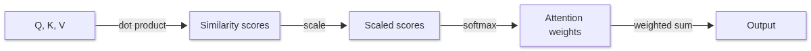

# How Transformer Attention Actually Works

## The Core Mechanics of Scaled Dot‑Product Attention


*Scaled dot‑product attention workflow.*


- **Q, K, V matrices** are obtained by multiplying the input embedding matrix \(X\) (size \(n \times d_{\text{model}}\)) with learned projection matrices \(W_Q, W_K, W_V\), giving \(Q, K, V \in \mathbb{R}^{n \times d_k}\).

- The **dot‑product \(K^\top \cdot Q\)** yields raw similarity scores \(S = K^\top Q\), where each element \(s_{ij} = k_i \cdot q_j\) measures how well key token \(i\) aligns with query token \(j\).

- The **scaling factor \(1/\sqrt{d_k}\)** divides the raw scores: \(S_{\text{scaled}} = S / \sqrt{d_k}\). This prevents large inner‑product magnitudes from pushing the softmax into extreme saturation, keeping the logits well‑conditioned.

- The **softmax step** is applied row‑wise: \(\alpha = \text{softmax}(S_{\text{scaled}})\), converting the raw scores into a probability distribution over keys for each query.

- The **final weighted sum** \(O = V \alpha\) produces the head output, a linear combination of all value vectors weighted by their attention scores.

## Minimal Working Example: Implementing Scaled Dot‑Product Attention

- **Import torch and set up dummy token embeddings** for a batch of sequences.  
```python
import torch
batch_size, seq_len, embed_dim = 2, 5, 8
x = torch.randn(batch_size, seq_len, embed_dim)   # (B, T, D)
```

- **Create linear layers for Q, K, V** and project the embeddings.  
```python
q_proj = torch.nn.Linear(embed_dim, embed_dim, bias=False)
k_proj = torch.nn.Linear(embed_dim, embed_dim, bias=False)
v_proj = torch.nn.Linear(embed_dim, embed_dim, bias=False)

Q = q_proj(x)   # (B, T, D)
K = k_proj(x)
V = v_proj(x)
```

- **Compute the scaled dot‑product, apply softmax, and multiply by V.**  
```python
scale = embed_dim ** -0.5
attn_scores = torch.matmul(Q, K.transpose(-2, -1)) * scale   # (B, T, T)
attn_weights = torch.softmax(attn_scores, dim=-1)
output = torch.matmul(attn_weights, V)                       # (B, T, D)
```

- **Verify shapes at each step** with assertions to catch dimension mismatches.  
```python
assert Q.shape == K.shape == V.shape == (batch_size, seq_len, embed_dim)
assert attn_scores.shape == attn_weights.shape == (batch_size, seq_len, seq_len)
assert output.shape == (batch_size, seq_len, embed_dim)
```

- **Run a forward pass and print the attention output** for inspection.  
```python
print("Attention output:\n", output)
```

This minimal example demonstrates the core mechanics of scaled dot‑product attention, ensuring every intermediate tensor has the expected shape before proceeding.

## Edge Cases, Numerical Stability, and Debugging Tips

- **Large dot‑product values**: Unscaled queries and keys produce huge logits, driving softmax toward 0 or ∞. Scaling by `1/√d_k` keeps logits in a numerically stable range, preventing underflow/overflow.  
- **Epsilon in denominator**: When normalizing scores, add a tiny `ε` (e.g., `1e‑9`) to the denominator of the softmax to avoid division by zero or loss of precision when scores are extremely negative.  
- **NaN/Inf detection**: Use `torch.isnan(attn_weights)` and `torch.isfinite(attn_weights)` to spot anomalous values early. Log or mask them before further computation.  
- **Padding masks**: Apply masks after scaling but before softmax. Ensure they are broadcastable to the attention matrix shape to avoid leaking padded positions into the context.  
- **Dimension checklist**: Verify that `Q`, `K`, `V` tensors all have shape `(batch, seq_len, d_model)` and that `d_model` is divisible by the number of heads (`num_heads`). Confirm reshaped tensors match `(batch, num_heads, seq_len, d_k)` before matmul.
