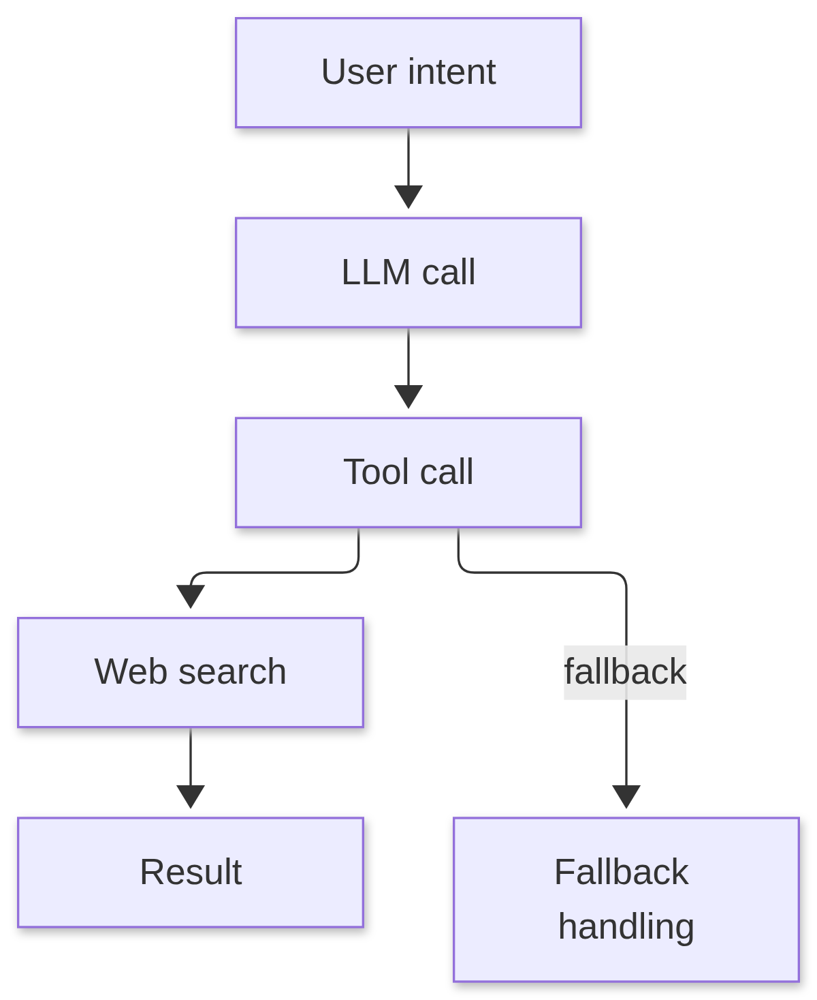

# The Rise of AI Agents in 2026: From Chatbots to Autonomous Systems

## Evolution Timeline: From Chatbots to Autonomous Agents


*Evolution of AI agents over time*


Early rule‑based chatbots such as ELIZA (1964) relied on pattern matching and keyword spotting, limiting them to scripted responses and shallow context retention. In the 2020‑2023 era, large‑language‑model (LLM) chat interfaces—most notably ChatGPT and Gemini—shifted the paradigm toward context‑aware, generative dialogue, enabling more natural user interactions [What Is Conversational AI in 2026?](https://www.cmswire.com/digital-experience/why-conversational-ai-is-so-much-more-than-a-chatbot).  

Around the same period, agentic frameworks emerged. AutoGPT and LangChain introduced modular tool‑use and planning capabilities, allowing LLMs to orchestrate external APIs and execute multi‑step tasks autonomously [How Autonomous AI Agents Are Reshaping Developer Workflows in 2026](https://dev.to/smartpicksai/how-autonomous-ai-agents-are-reshaping-developer-workflows-in-2026-4ho6).  

By 2026, 31 % of financial services had deployed autonomous agents, underscoring industry adoption [Agentic AI Adoption Statistics for 2026 – First Page Sage](https://firstpagesage.com/reports/agentic-ai-adoption-statistics).  

Looking ahead, the trajectory points toward self‑optimizing digital twins and sandboxed imagination engines that continuously learn and simulate environments for predictive decision‑making.

## Building a Minimal Autonomous Agent (MWE)


*Minimal autonomous agent workflow*


```python
import time
import random

# --- tool -------------------------------------------------
def web_search(query: str) -> str:
    """Mock web‑search that randomly fails."""
    if random.random() < 0.2:   # 20 % failure
        raise RuntimeError("search timeout")
    return f"Results for '{query}'"

# --- agent -------------------------------------------------
def llm_call(intent: str) -> str:
    """Pretend LLM turns intent into a tool call."""
    # For demo: always ask for a web search
    return f"search:{intent}"

def run_agent(user_intent: str):
    start_llm = time.perf_counter()
    tool_call = llm_call(user_intent)
    llm_time = time.perf_counter() - start_llm

    tool_name, tool_arg = tool_call.split(":", 1)
    start_tool = time.perf_counter()
    try:
        if tool_name == "search":
            result = web_search(tool_arg)
    except Exception as e:
        result = f"fallback: {e}"
    tool_time = time.perf_counter() - start_tool

    print(f"LLM time: {llm_time:.3f}s | Tool time: {tool_time:.3f}s")
    print(result)

# --- entry point -------------------------------------------
if __name__ == "__main__":
    run_agent("Python list comprehensions")
```

Run locally with:

```
python agent.py
```

## Operational Edge Cases & Debugging Strategies

- **Hallucination**: Agents may fabricate actions without external verification. Detect this by cross‑checking each proposed action against a trusted state store or API contract before execution.  
- **Resource Exhaustion**: Recursive planning can spiral, consuming CPU, memory, and API quotas. Enforce a hard depth limit (e.g., 5–7 levels) and a time budget per planning cycle.  
- **Fallback Strategies**: When limits are hit or uncertainty is high, trigger human‑in‑the‑loop escalation or route the task to a safe‑sandbox environment where the agent can be replayed without side effects.  
- **Observability**: Log every intent, LLM output, and tool result as structured JSON. Include timestamps, context IDs, and confidence scores to enable post‑mortem analysis.  
- **Debugging Tip**: Re‑play a failure by feeding the stored JSON logs back into the agent pipeline; this deterministic replay surfaces hidden race conditions or data drift.
